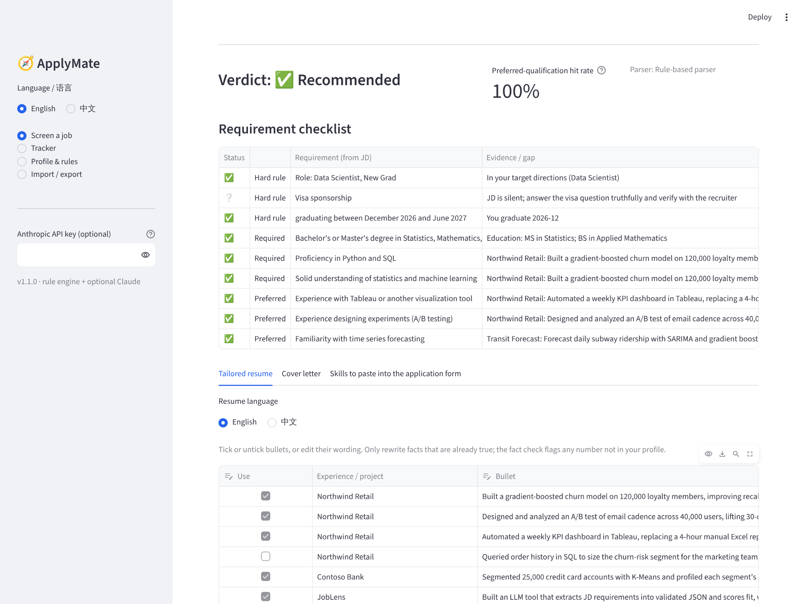
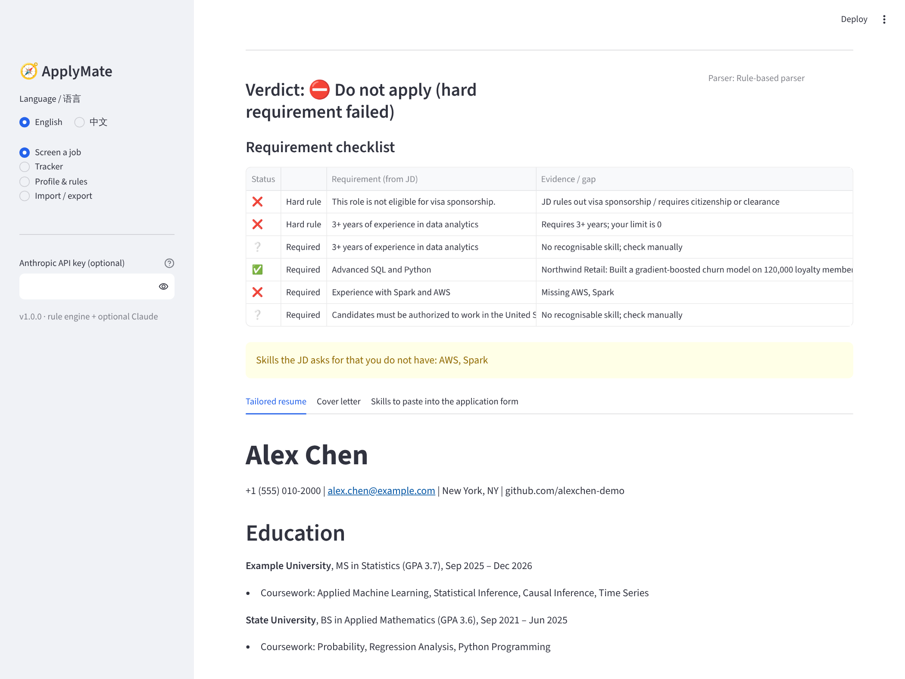
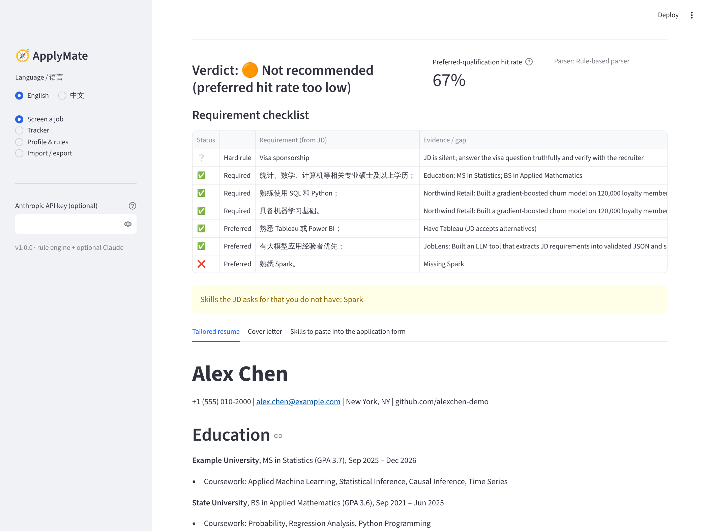
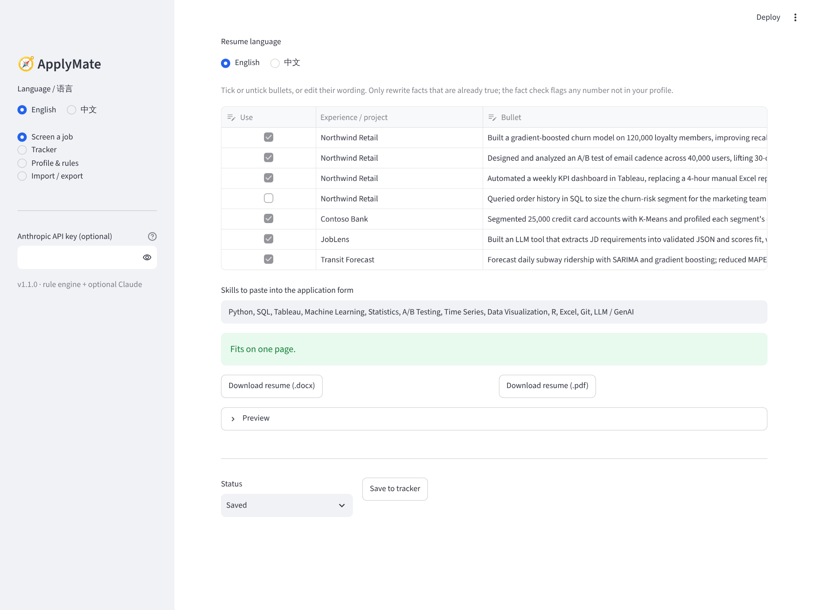
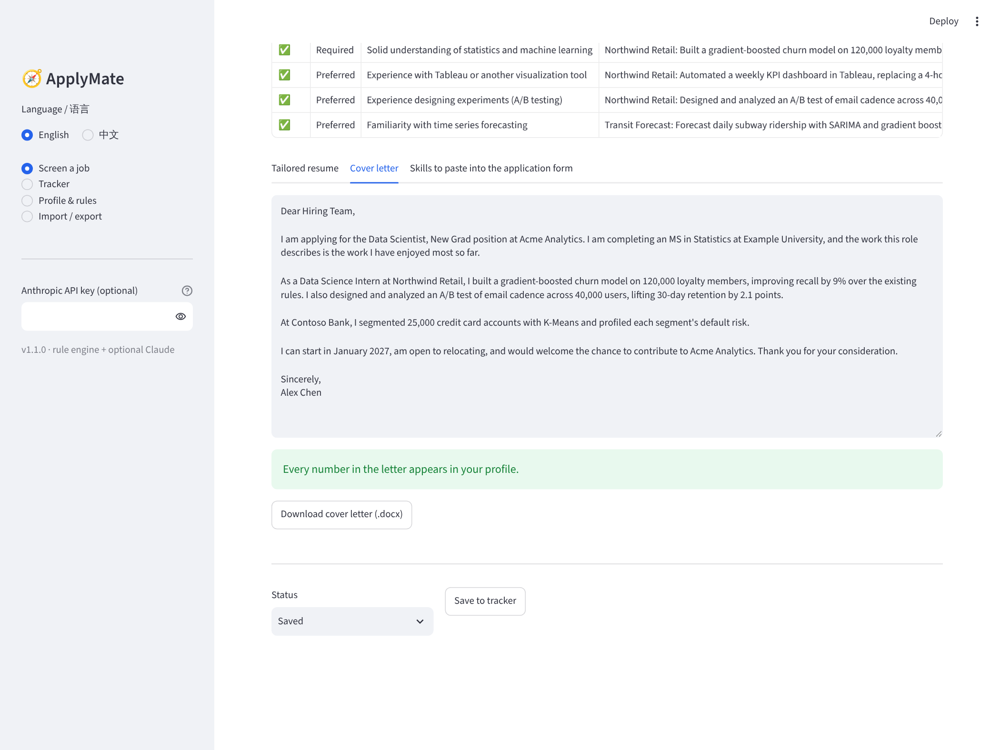
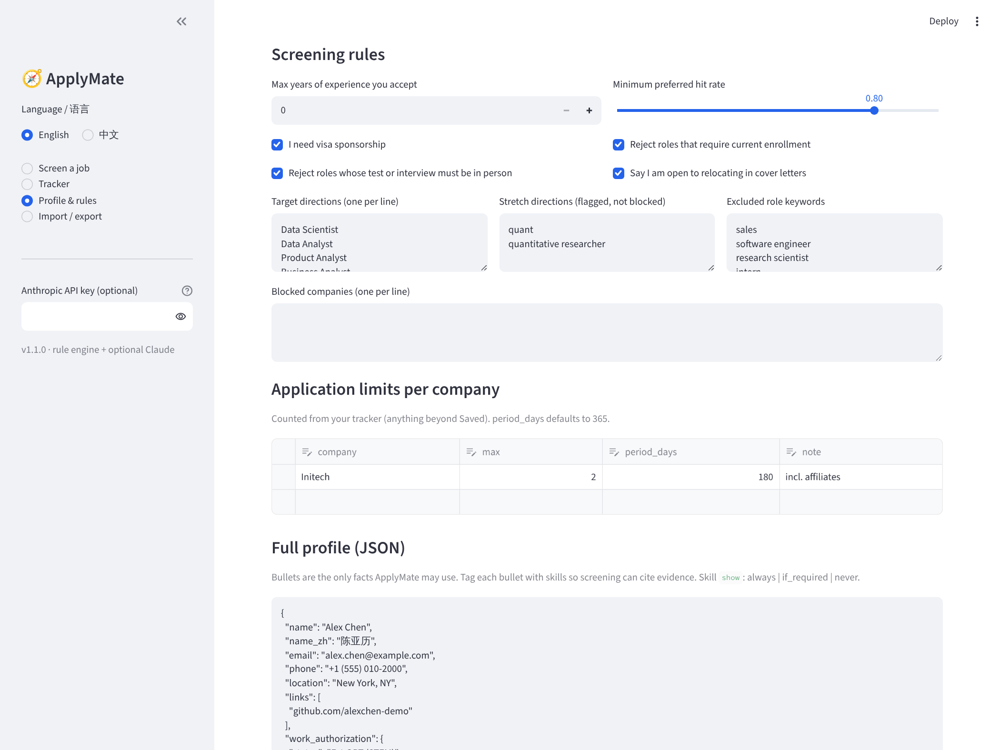
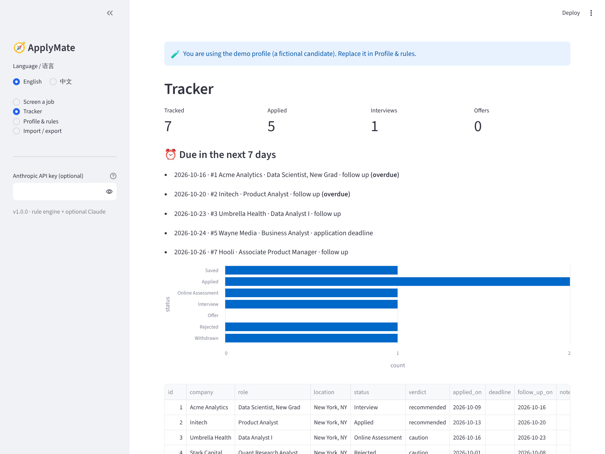
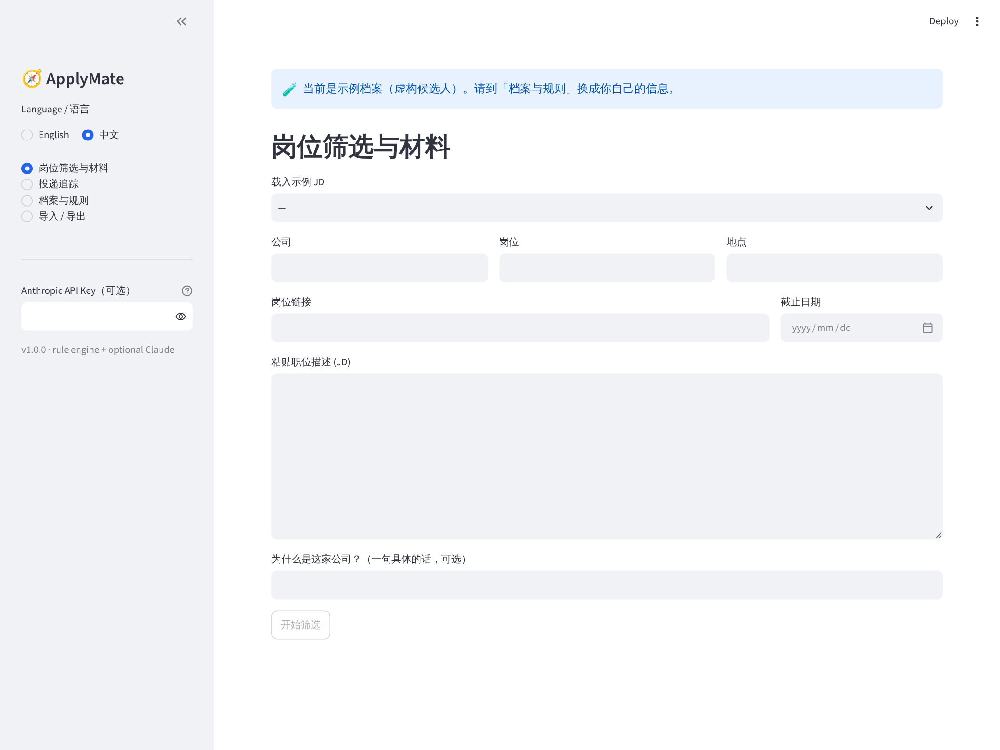

# 🧭 ApplyMate

**English** · [中文](#中文说明)

ApplyMate is a job-application copilot for new-grad candidates. Paste a job description and it will:

1. **Screen** the JD against your hard rules (role direction, sponsorship, years of experience, graduation window, enrollment requirements, in-person-only assessments, staffing firms, per-company application caps, blocked companies) and score how many *preferred* qualifications you meet.
2. **Tailor** a one-page resume in English or Chinese by re-ranking your own bullets and skills for that JD, then let you tick, untick or reword bullets with a live one-page check.
3. **Draft** a cover letter built only from facts in your profile, with a **fact guard** that flags any number not found in your profile.
4. **Track** every application in a local SQLite tracker with follow-up reminders and a status funnel.

The UI switches between English and Chinese, and it works fully offline with a rule engine. Adding an Anthropic API key turns on Claude for requirement extraction and letter polishing. Claude output that fails validation is discarded, and the rule engine's result is kept.



| Hard fail (no sponsorship, 5+ years) | Chinese JD, preferred rate below threshold |
|---|---|
|  |  |

| Editable resume with one-page check | Cover letter with live fact check |
|---|---|
|  |  |

| Screening rules | Application tracker |
|---|---|
|  |  |

## Features

| Area | What it does |
|---|---|
| JD parser | Splits English and Chinese JDs into responsibilities, required and preferred items (`Requirements`, `Nice to have`, `任职要求`, `加分项`, `1、…`). |
| Screening | Checks each line: ✅ pass, ⚠️ partial, ❌ fail, ❔ unknown. Silence on sponsorship is reported as *unknown*, not as a pass. Verdicts: Do not apply, Not recommended, Apply with caution, Recommended. |
| Direction & caps | Role titles are matched against your target, stretch (flagged) and excluded directions. Per-company caps (e.g. 2 per 180 days) are counted from your tracker. |
| Risk flags | Staffing / placement firms are flagged. Roles whose test or interview must be taken in person are rejected unless the JD offers an online option. |
| Skill taxonomy | About 30 canonical skills with synonyms (e.g. `PostgreSQL` → `SQL`, `机器学习` → `Machine Learning`). An "A or B" requirement passes if you have either one. |
| Resume tailoring | Keeps every job (no gaps). Ranks bullets by skill hits, keyword overlap and quantified results. Skills can be `always`, `if_required` (only when a *required* line asks) or `never` shown, optionally extended to the bullets that mention them. Single bullets can be `never` shown or shown only when the JD needs a given skill. |
| One-page guarantee | The resume is laid out with real font metrics; ApplyMate drops the lowest-ranked bullets until it fits (never a whole job) and re-checks after every edit. Verified against Word rendering with a safety margin. |
| English / 中文 resume | Add `*_zh` fields (`org_zh`, `text_zh`, …) to your profile and switch the resume language; Chinese dates and punctuation are handled. |
| Cover letter | Four-paragraph draft. Names missing skills honestly instead of claiming them. Optional no-dash style and relocation line. |
| Fact guard | Every number in the letter must appear in your profile. The Claude rewrite is rejected if it introduces new numbers. |
| Export | One-page `.docx` and `.pdf` resume, `.docx` cover letter, tracker CSV/JSON. Files are named `Name resume Company Role`. |
| Tracker | Statuses from Saved to Offer. Applied date and a +7-day follow-up are set automatically. Shows due and overdue items. |

## Quick start

```bash
git clone https://github.com/<you>/applymate.git
cd applymate
pip install -r requirements.txt
streamlit run app.py
```

The app opens with a fictional demo profile ("Alex Chen") and three sample JDs. Go to **Profile & rules** to paste your own profile JSON (see `profile.example.json`). Your profile and tracker are stored in `data/`, which is git-ignored.

### Optional: Claude

Paste an Anthropic API key in the sidebar. The key is held only in the session and never written to disk.

## Architecture

```
app.py                 Streamlit UI (4 pages, EN/中文)
applymate/
  jd_parser.py         section splitting, years-of-experience extraction
  skills.py            canonical skill taxonomy + synonyms
  screening.py         hard rules, preferred hit rate, verdict
  tailor.py            bullet ranking, cover letter draft, fact guard
  llm.py               optional Claude calls with schema validation + fallback
  export.py            one layout → Markdown / .docx / .pdf, page count, auto-fit
  tracker.py           SQLite application tracker
  profile.py           profile load/save, demo profile
  i18n.py              UI strings (en, zh)
  samples.py           fictional sample JDs
tests/                 pytest suite (runs in CI)
```

Design choices:

- **Rules first, LLM second.** Deterministic screening is explainable and testable. Claude is an optional add-on, never a dependency.
- **Never invent facts.** Generated text is assembled only from profile content, and the fact guard checks every number.
- **Local by default.** No account and no server-side storage.

## Tests

```bash
pip install -r requirements-dev.txt
pytest -q
```

31 tests cover parsing, every screening rule, bullet rules, the fact guard, one-page fitting in both languages and the tracker. GitHub Actions runs them on every push.

## Deploy

Push to GitHub, then create an app on [Streamlit Community Cloud](https://streamlit.io/cloud) pointing at `app.py`. `packages.txt` installs a Chinese font so Chinese PDFs render there too. Note that `data/` on a hosted instance is temporary, so use **Import / Export** to keep your tracker.

## License

MIT © 2026 Yuxuan Ji

---

## 中文说明

ApplyMate 是一个面向应届生的求职助手。粘贴一段职位描述（JD），它会：

1. **筛选**：按你的硬性规则逐条检查 JD（岗位方向、签证担保、工作年限、毕业时间窗口、是否要求在读、是否只能线下笔试面试、中介外包公司、每家公司的投递上限、公司黑名单），并计算加分项命中率。
2. **定制简历**：针对这个 JD 重新排序你自己的经历要点和技能，生成中文或英文一页简历；可以在界面里勾选、取消、改写要点，并实时检查是否超过一页。
3. **起草求职信**：只用档案里已有的事实。**事实校验**会标出任何档案里找不到的数字。
4. **投递追踪**：本地 SQLite 记录每一次投递，自动设置跟进提醒，并显示状态漏斗。

界面支持中英文切换。不联网时用规则引擎即可完整运行。填入 Anthropic API Key 后，可以用 Claude 抽取要求和润色求职信。Claude 的输出如果没通过校验会被丢弃，保留规则引擎的结果。



### 功能

| 模块 | 说明 |
|---|---|
| JD 解析 | 支持中英文 JD，识别「岗位职责」「任职要求」「加分项」以及「1、2、」编号。 |
| 筛选 | 每条要求标记为 ✅ 符合、⚠️ 部分、❌ 不符合、❔ 未知。JD 没提签证担保时记为「未知」，不算通过。结论分四档：不要投、不推荐、谨慎投递、推荐。 |
| 方向与上限 | 按岗位名称判断是否属于目标方向、冲刺方向（提示）或排除方向；按追踪表统计每家公司的投递上限（如 180 天内 2 个）。 |
| 风险提示 | 识别中介、外包公司并提示；笔试或面试只能线下参加的岗位直接排除，JD 写了可线上参加的则提示确认。 |
| 技能词库 | 约 30 个标准技能及同义词。「A 或 B」类要求只要会其中一个就算符合。 |
| 简历定制 | 保留所有经历避免空档。按技能命中、关键词和量化结果排序要点。技能可设为总是显示、只在必须项要求时显示、从不显示，并可让同一规则作用到提到该技能的经历要点；单条要点也可设为永不显示或只在 JD 需要某技能时显示。 |
| 一页保证 | 用真实字体尺寸排版，超出一页时自动去掉排序最低的要点（不会删掉整段经历），每次修改后重新检查。已与 Word 实际渲染对照验证，并留有安全余量。 |
| 中英文简历 | 档案中加上 `*_zh` 字段即可切换中文简历，日期和标点自动按中文格式。 |
| 求职信 | 四段式初稿。缺少的技能如实说明，不会冒充已掌握。可选不用破折号、写明愿意搬迁。 |
| 事实校验 | 信中每个数字都必须在档案中出现。Claude 润色若引入新数字则被拒绝。 |
| 导出 | 一页 Word 和 PDF 简历、Word 求职信、追踪表 CSV/JSON。文件名为「姓名 resume 公司 岗位」。 |
| 投递追踪 | 从「已保存」到「Offer」的状态管理，自动记录投递日期和 7 天后跟进日期，显示到期和逾期事项。 |

### 运行

```bash
pip install -r requirements.txt
streamlit run app.py
```

首次打开会载入虚构示例档案和三个示例 JD。到「档案与规则」页面粘贴你自己的档案 JSON（格式见 `profile.example.json`）。档案和追踪数据保存在 `data/` 目录，已在 `.gitignore` 中排除，不会上传。

### 设计原则

- **规则优先，大模型可选**：筛选结果可解释、可测试，不依赖任何 API。
- **绝不编造**：生成内容只来自档案，数字逐一校验。
- **默认本地**：无需注册，数据不上传服务器。

### 测试与部署

`pytest -q` 运行测试，GitHub Actions 会在每次推送时自动运行。部署可使用 Streamlit Community Cloud，入口文件为 `app.py`。
